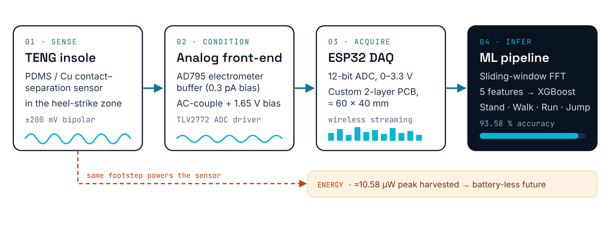
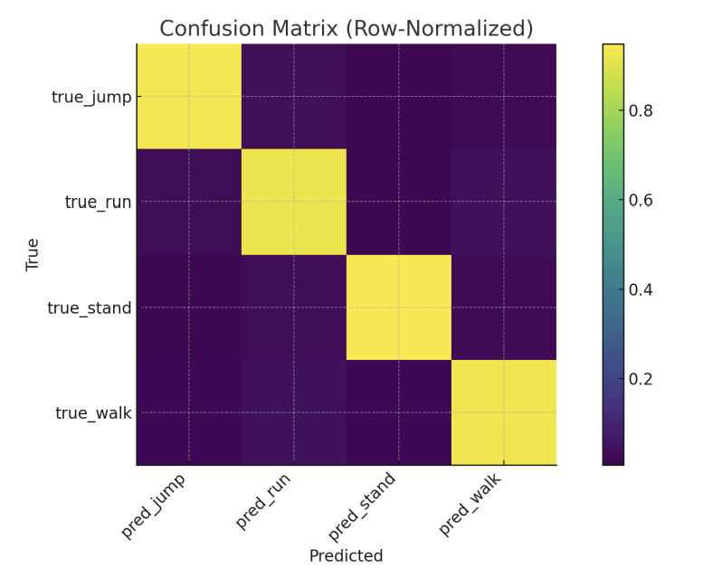
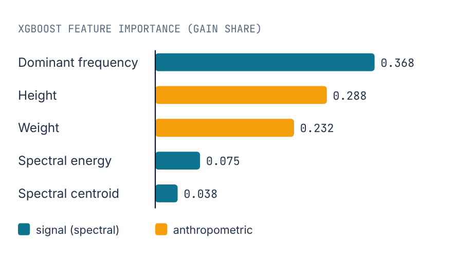
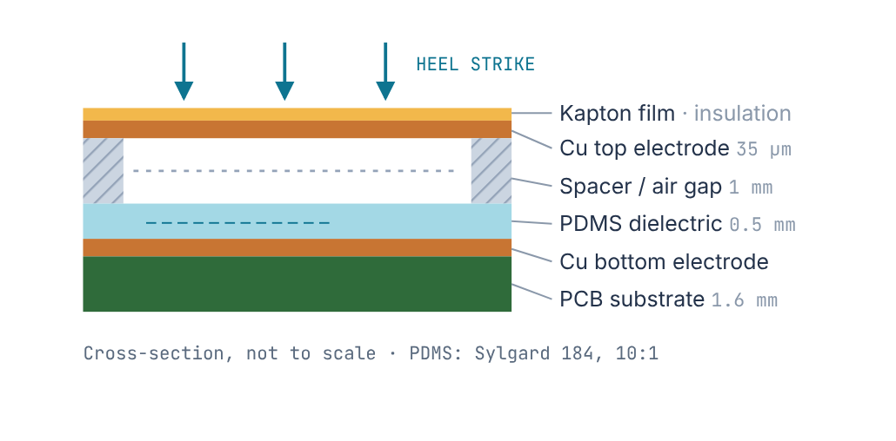
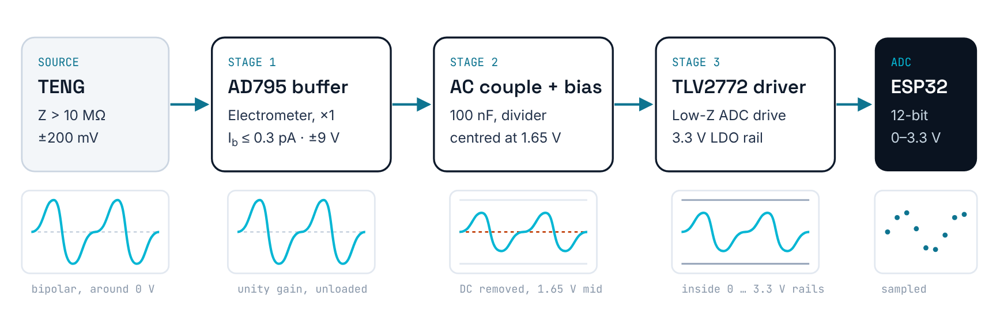
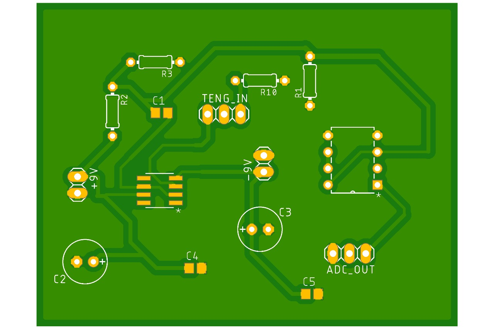
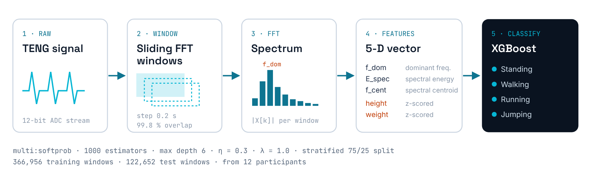

<h1 align="center">TENG Gait Wearable</h1>

<p align="center">
  <b>An intelligent, energy-aware shoe insole for continuous gait analysis in rehabilitation</b><br>
  <sub>M.Sc. thesis · Albert-Ludwigs-Universität Freiburg · IMTEK, Laboratory for the Design of Microsystems &amp; livMatS · 2025</sub>
</p>

<p align="center">
  
  
  
  
  
  
</p>

<p align="center"></p>

## Why

Clinical gait analysis takes place in a lab and captures a short snapshot. An estimated **2.4 billion people** have a health condition that could benefit from rehabilitation, yet how a patient actually walks at home, between appointments, is rarely measured.

This project turns an ordinary shoe insole into a gait sensor that **powers its own sensing**: a triboelectric nanogenerator (TENG) converts the mechanical energy of each footstep into the measured signal.

## Results at a glance

| | |
|---|---|
| **Classification accuracy** | **93.58 %** on 122,652 held-out windows (standing · walking · running · jumping) |
| **Per-class F1** | 0.93 – 0.95 (macro average 0.94) |
| **Study** | 12 healthy adults · 7 trials each · 84 recordings |
| **TENG output** | ≈ 800 mV open-circuit · 10.58 µW peak power during gait |
| **Most important feature** | Dominant frequency (0.368), which tracks cadence |

<p align="center">
  
  &nbsp;
  
</p>

## How it works

### 1 · Sensor: a self-powered transducer
A contact-separation TENG with a **PDMS** dielectric and **copper** electrodes (2 × 2 cm active area) sits in the heel-strike zone of the right insole. Heel strike closes a 1 mm gap; separation drives charge back through the electrodes. The number of layers was optimised experimentally (3 → 6) to increase signal amplitude.

<p align="center"></p>

### 2 · Analog front-end: solving the impedance problem
A TENG is a very high-impedance source, so a normal ADC input would load it and destroy the signal. The custom three-stage board:

1. **AD795 electrometer buffer**: unity gain, input bias ≤ 0.3 pA, so the error across a 10 MΩ source stays below 50 µV
2. **AC coupling + 1.65 V bias**: centres the bipolar ±200 mV waveform at mid-rail
3. **TLV2772 output buffer**: low-impedance drive into the ESP32's 12-bit ADC (3.3 V from an NCV8114 LDO)

<p align="center"></p>

The two-layer PCB (≈ 60 × 40 mm) keeps the TENG input trace short, uses split ±9 V / 3.3 V power domains with a single-point analog/digital ground, and has modular connectors for the sensor, batteries and ADC.

<p align="center"></p>

### 3 · Machine learning: from waveform to activity
<p align="center"></p>

* **Sliding-window FFT** with a 0.2 s hop (99.8 % overlap)
* **Features:** dominant frequency, spectral energy, spectral centroid + z-scored height and weight
* **Model:** XGBoost (`multi:softprob`, 1000 trees, depth 6, η = 0.3, λ = 1.0)

I chose gradient-boosted trees over an LSTM on purpose: they train in minutes rather than hours, show which feature drives each decision, and are compact enough for on-device inference.

## Code

The analysis code lives in its own repository: **[ajeethv27/Gait_Analysis_Project](https://github.com/ajeethv27/Gait_Analysis_Project)**. It contains the Jupyter notebook (`gait_analysis_ml.ipynb`) covering data loading, signal visualisation, feature extraction and the XGBoost models, plus `requirements.txt` and setup instructions.

```bash
git clone https://github.com/ajeethv27/Gait_Analysis_Project
cd Gait_Analysis_Project
python -m venv venv && source venv/bin/activate   # Windows: .\venv\Scripts\Activate.ps1
pip install -r requirements.txt
jupyter notebook gait_analysis_ml.ipynb
```

## Limitations and next steps

I would rather state these openly than have a reviewer find them:

- **Window-level split.** The reported 93.58 % uses a stratified split over windows, so windows from the same recording can appear in both training and test sets. Leave-one-subject-out cross-validation is the stricter next benchmark.
- **Anthropometric features** (height 0.288, weight 0.232) carry about half of the importance. The model needs to be checked for generalisation to unseen bodies rather than partly recognising individuals.
- **Dataset:** 12 healthy adults in a lab setting. Clinical populations and in-the-wild data come next.
- **Roadmap:** on-board energy harvesting and power management for a battery-less insole, TENG + IMU fusion, and on-device ESP32 inference for real-time feedback.

## Repository layout

```
docs/   figures used in this README
```

Analysis code: [Gait_Analysis_Project](https://github.com/ajeethv27/Gait_Analysis_Project).

## Acknowledgements

Supervised by Prof. Dr.-Ing. Peter Woias (first examiner) and Dr.-Ing. Laura Maria Comella (second examiner), with day-to-day guidance from Fiza Asif (livMatS). The PDMS dielectric was developed within the supervising group.

## Contact

**Ajeeth Venkat Prasat** · Embedded Systems Engineer · [LinkedIn](https://www.linkedin.com/in/ajeethv) · [ajeethvp@gmail.com](mailto:ajeethvp@gmail.com) · [Portfolio](https://ajeethv27.github.io)
